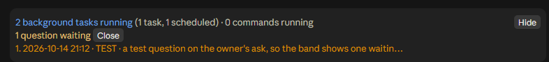
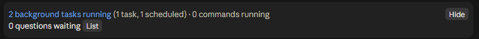
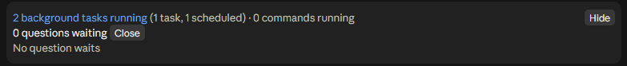

# Glance Band

A band above Claude Code's prompt that tells you, at a single glance, what Claude is doing - and whether one of its
questions is waiting for your answer.



## What it shows

**Row 1 - the work**

- **N background tasks running** - background shells, agents, monitors and workflows, plus scheduled loops
  (`/loop`, CronCreate, wakeups). **Blue** while anything runs, **grey** at zero, **lilac** when the only thing running
  is a loop. A grey note says what is running: `(1 task, 1 scheduled)` or `(loop)`.
- **N commands running** - shell commands (Bash, PowerShell) running right now. **Green** while any run.
- **writing a command** - **brown**, while Claude is still writing a shell command and before it runs. Shown only then.
- **Hide / Show** - folds the band down to a single button (or type `/band`).

**Row 2 - your turn**

- **N questions waiting** - **white** at zero, a calm **yellow** from one - with a **List** button that unfolds the
  open questions under it (**Close** folds them again; with none waiting it says "No question waits").





## Install

In a terminal Claude Code session:

```text
/plugin install glance-band --marketplace AzalorisTheEmolian/glance-band
```

Answer `y` to add the marketplace, then choose a scope (user scope gives you the band in every project). The command
is not accepted in the desktop app's Code tab, but a plugin installed at user scope from a terminal shows its band there
too. Glance Band is a "mod" (a plugin of function hooks); it was built and tested on Claude Code 2.1.295.

## The questions file

The counter reads one Markdown file. Every line that starts with `- [ ] ` is a question waiting; every line that starts
with `- [x] ` is answered and no longer counted:

```markdown
- [ ] 2026-10-14 20:30 · the release · ship today or tomorrow?
- [x] 2026-10-14 18:52 · the README wording - answered: keep it short
```

By default the file is `<your home folder>/.claude/questions_waiting.md`. Glance Band adds a short section to Claude's
system prompt asking it to write each question it puts to you into that file in the same step, and to tick it off once
you answer - so a glance at the band tells you whether Claude is waiting on you, without asking "do you have any
questions for me?". You can edit the file by hand too; the band re-reads it every two seconds.

## Settings

Set at install, or later in `/config`:

| Setting | Default | What it does |
| :- | :- | :- |
| `questions_file` | empty | The Markdown file the counter reads. Empty means `<home>/.claude/questions_waiting.md`. |
| `teach_claude` | on | Adds the system-prompt section that asks Claude to keep the questions file (about 120 tokens per request). Turn it off if you keep the file another way. |

## How the counts stay true

At the end of every turn, Claude Code's own Stop event carries the session's in-flight background tasks and its
scheduled jobs - the whole truth, once a turn. Between turn ends the band moves live: a background launch, a
`TaskStop`, a `CronCreate` or a `CronDelete` counts the moment its tool call returns, and every two seconds the output
file of each running background shell is read for the line Claude Code writes when a shell ends (`[killed]` - a stop
from the tasks panel too, which raises no event a plugin can hear - or `[exited with code N]`).

## Your data: what it reads, holds, causes to be stored, and what leaves your computer

- **Reads, keeps nothing from:** the session's own events; the output files of running background shells (only their
  last line, to see when one ends); the `HOME` and `USERPROFILE` environment variables (only to find your home folder).
- **Holds for the session only:** the counts, the IDs of running shells and their output files' paths, and **the text
  of your open questions** - in Claude Code's session memory, gone when the session ends (it survives only a reload of
  the plugin). Glance Band uses no persistent plugin storage. Note: Claude Code lets any other plugin in the same
  session read these values.
- **Causes storage - one file on your disk:** with `teach_claude` on (the default), Glance Band asks Claude to write
  each question it puts to you into the questions file (by default `<home>/.claude/questions_waiting.md`). The plugin's
  own code writes nothing, but that file exists because of it, holds whatever your questions say, and **stays until
  you delete it**. Turn `teach_claude` off and Glance Band causes no storage at all.
- **What leaves your computer:** the plugin itself makes no network calls. With `teach_claude` on, the note it adds to
  Claude's system prompt includes the questions file's path - which contains your home folder's name - and is sent to
  Anthropic's model with every request, through Claude Code's own channel; when Claude edits the questions file, its
  contents pass through the model like any file Claude edits. Nothing goes to any other service.
- **Context cost:** with `teach_claude` on, one short system-prompt section (about 120 tokens per request); off,
  nothing.

## Known limits

- The desktop app paints every button's text in its own white, whatever colour a plugin asks for - so the counts are
  plain text beside small buttons, not coloured buttons.
- Mods (function hooks) are an early-access API; a later Claude Code release may change what the band can do.
- Anything the band cannot hear between turn ends is corrected at the next turn's end.

## License

MIT - see [LICENSE](LICENSE).
