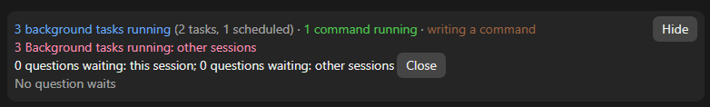
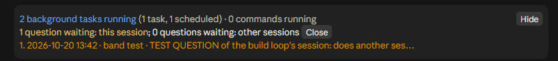
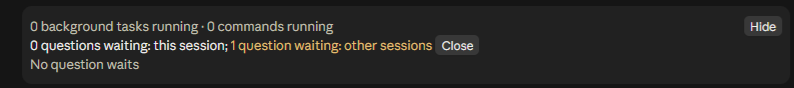

# Glance Band

A band above Claude Code's prompt that tells you, at a single glance, what Claude is doing - and whether one of its
questions is waiting for your answer.



## What's new

**1.3.0 - your other sessions' tasks.** A new pink row under the first: "N Background tasks running: other sessions",
so a glance tells you whether another session is still busy. To count them, each session's band keeps one tiny file on
your disk, and the numbers never leave your computer; see [Your data](#your-data-what-it-reads-holds-causes-to-be-stored-and-what-leaves-your-computer).
Turn it off with the `other_sessions_tasks` setting.

**1.2.0 - questions per session.** All your sessions share one questions file, so a question Claude asked in one
session used to be counted, and listed, in every other. Now each session keeps its questions in a section of its own,
and the band reads "N questions waiting: this session; M questions waiting: other sessions" - the List shows only the
questions of the session you are looking at. Claude is told which section is its own, so after a compaction too it
asks you only its own session's questions. See [The questions file](#the-questions-file).

**1.1.1** - "searching" is shown while a search Claude started (Grep or Glob) runs. **1.1.0** - what Claude is
writing, for files too: "creating a file", "rewriting a file", "editing a file".

Every version's changes: [CHANGELOG.md](CHANGELOG.md).

## What it shows

**Row 1 - the work**

- **N background tasks running** - background shells, agents, monitors and workflows, plus scheduled loops
  (`/loop`, CronCreate, wakeups). **Blue** while anything runs, **grey** at zero, **lilac** when the only thing running
  is a loop. A grey note says what is running: `(1 task, 1 scheduled)` or `(loop)`.
- **N commands running** - shell commands (Bash, PowerShell) running right now. **Green** while any run.
- **searching** - **brown**, while a search Claude started (Grep or Glob - what Claude Code draws as "Searching
  ...") runs; **running N searches** when several run at once. A search over a large folder can take minutes, and
  until 1.1.1 the band showed nothing while one ran.
- **What Claude is writing** - **brown**, from the moment Claude starts writing a call until it runs. Shown only then:
  - **writing a command** - a shell command;
  - **creating a file** - a whole new file;
  - **rewriting a file** - a whole file that replaces one already on disk (the band tells the two apart as soon as the
    file's name streams in, a split second after the label appears);
  - **editing a file** - a change to part of a file; **making N edits** when several wait together (they may all be
    to one file).

  Each kind is counted on its own and they share one line, joined by a dot. Claude Code sometimes runs each call as
  soon as it is written and sometimes holds several until the last is written, so you may see one label or several.
  Reading a file is not shown: it is over in a blink.
- **Hide / Show** - folds the band down to a single button (or type `/band`).

**Row 2 - your other sessions' work**

- **N Background tasks running: other sessions** - every other session's first-row number added up, its loops included.
  **Pink** from one, **grey** at zero. A session that has ended leaves the row within 30 seconds. Since 1.3.0; only
  sessions running 1.3.0 or later are counted.

**Row 3 - your turn**

- **N questions waiting: this session; M questions waiting: other sessions** - each count **white** at zero, a calm
  **yellow** from one - with a **List** button that unfolds **this session's** open questions under it (**Close** folds
  them again; with none waiting in this session it says "No question waits"). Every session shares one questions file,
  so a question Claude asked you in another session is counted under "other sessions" and never listed here - since
  1.2.0.



The same question seen from another session - counted, not listed:



## Install

In a terminal Claude Code session:

```text
/plugin install glance-band --marketplace AzalorisTheEmolian/glance-band
```

Answer `y` to add the marketplace, then choose a scope (user scope gives you the band in every project). The command
is not accepted in the desktop app's Code tab, but a plugin installed at user scope from a terminal shows its band there
too. Glance Band is a "mod" (a plugin of function hooks); it was built on Claude Code 2.1.295 and this version was tested
on 2.1.309.

## The questions file

The counter reads one Markdown file, shared by all your sessions. Every line that starts with `- [ ] ` is a question
waiting; every line that starts with `- [x] ` is answered and no longer counted. Each session's questions stand in a
section of their own, between the session's two lines:

```markdown
## session 0b7e4c2a-5d1f-4e8b-9a36-2f0c8d1e7b45
- [ ] 2026-10-14 20:30 · the release · ship today or tomorrow?
- [x] 2026-10-14 18:52 · the README wording - answered: keep it short
<!-- end of session 0b7e4c2a-5d1f-4e8b-9a36-2f0c8d1e7b45 -->
```

The id is the session's own id - the name of its transcript file - which stays the same when you rename the session,
so a session's name is never used. The band counts the open lines of the session you are looking at, lists only
those, and counts every other open line - in another session's section, or outside every section - under "other
sessions".

By default the file is `<your home folder>/.claude/questions_waiting.md`. Glance Band adds a short section to Claude's
system prompt that names the session's id and its section, and asks Claude to write each question it puts to you into
that section in the same step, to tick it off once you answer, and to ask you only the questions of its own section -
so a glance at the band tells you whether Claude is waiting on you, without asking "do you have any questions for
me?". The section is sent with every request, so it holds after a conversation is compacted too. You can edit the file
by hand; the band re-reads it every two seconds.

## Settings

Set at install, or later in `/config`:

| Setting | Default | What it does |
| :- | :- | :- |
| `questions_file` | empty | The Markdown file the counter reads. Empty means `<home>/.claude/questions_waiting.md`. |
| `teach_claude` | on | Adds the system-prompt section that asks Claude to keep the questions file, in the session's own section (about 300 tokens per request). Turn it off if you keep the file another way. |
| `other_sessions_tasks` | on | Draws the row "N Background tasks running: other sessions" and keeps this session's tiny file in `<home>/.claude/band_tasks`. Off, the row is not drawn and nothing is written or read there. |

## How the counts stay true

At the end of every turn, Claude Code's own Stop event carries the session's in-flight background tasks and its
scheduled jobs - the whole truth, once a turn. Between turn ends the band moves live: a background launch, a
`TaskStop`, a `CronCreate` or a `CronDelete` counts the moment its tool call returns, and every two seconds the output
file of each running background shell is read for the line Claude Code writes when a shell ends (`[killed]` - a stop
from the tasks panel too, which raises no event a plugin can hear - or `[exited with code N]`).

A plugin cannot ask another session anything, so each band tells the others. It keeps one small file of its own in
`<home>/.claude/band_tasks`, named by its session's id and holding its first row's number, and every band adds up the
others' files every two seconds. A file has one writer, so no session can overwrite another's count. While a session's
number stands above zero its file is written again every 10 seconds, and a file older than 30 seconds is a session that
has ended, so it is no longer counted. Zero is written once, and a session that never ran a task writes nothing.

## What each hook does

Glance Band is a mod: one hooks module (`hooks/register.tsx`). Every hook it registers, and what it does or changes:

| Hook | What it does | Changes anything? |
| :- | :- | :- |
| `session.start` | Registers the `/band` command, reads the questions file and the other sessions' task files once, starts a 2-second timer that re-reads them and the running shells' output files and keeps this session's own task file current | Only its own task file in `<home>/.claude/band_tasks` |
| `command.run` for `/band` | Answers the plugin's own `/band` command: folds or unfolds the band | Only its own command |
| `prompt.compose` | With `teach_claude` on, adds ONE section at the end of Claude's system prompt: the note asking Claude to keep the questions file in the session's own section, which it names by the session's id (its text is in `hooks/register.tsx`, `QUESTIONS_NOTE`). Every other section passes through untouched | Adds that one section; nothing else |
| `classic.Stop` | At each turn's end, reads the session's in-flight background tasks and scheduled jobs to set the counts, and writes this session's number to its own task file when it moved | Only its own task file in `<home>/.claude/band_tasks` |
| `turn.step` | Watches Claude's reply as it streams, to notice a shell command, a file or an edit being written; for a whole-file write it reads the file's name from the streamed arguments and asks only whether that path already exists. Every piece passes through unchanged | No |
| `tool.call` | Ends a "being written" label when its call starts; counts a shell command or a search (Grep, Glob) while it runs, and a background launch, `TaskStop`, `CronCreate` or `CronDelete` when its call returns. Every tool call is passed on as made and its result returned as given; it never blocks, delays or rewrites a call | No |
| `ui.render` for the band above the prompt | Draws the band | Draws its own band only |

## Your data: what it reads, holds, causes to be stored, and what leaves your computer

- **Reads, keeps nothing from:** the session's own events; **the session's id** (its transcript file's name, from
  Claude Code - only to find the session's section of the questions file and to name it in the note); the output files
  of running background shells (only their last line, to see when one ends); the `HOME` and `USERPROFILE` environment
  variables (only to find your home folder); the small task files of your other sessions in
  `<home>/.claude/band_tasks` (a number each, added up, and each file's age);
  and, when Claude writes a whole file, **whether that file's path already exists** - a yes or no from your disk, to
  choose between "creating" and "rewriting"; the file itself is never opened or read.
- **Holds for the session only:** the counts, the IDs of running shells and their output files' paths, and **the text
  of your open questions** - in Claude Code's session memory, gone when the session ends (it survives only a reload of
  the plugin). Glance Band uses none of Claude Code's persistent plugin storage. Note: Claude Code lets any other plugin
  in the same session read these values.
- **Holds for a moment only:** while Claude starts writing a whole file, the first streamed pieces of that call's
  arguments, in the plugin's own memory, until the file's name can be read from them (in practice the name comes
  first, so this is the name itself) - then dropped; nothing of them is kept, shown or sent.
- **Writes - one tiny file per session on your disk (since 1.3.0):** with `other_sessions_tasks` on (the default), the
  band writes `<home>/.claude/band_tasks/<session id>.txt`, holding only that session's number of background tasks. A
  session that never runs a task writes nothing. Plugins cannot delete files, so **these files stay until you delete
  them**; a file is a few bytes, the folder holds one per session that ever ran a task, and emptying it is harmless.
- **Causes storage - one file on your disk:** with `teach_claude` on (the default), Glance Band asks Claude to write
  each question it puts to you into the questions file (by default `<home>/.claude/questions_waiting.md`). The plugin's
  code does not write that file, but it exists because of the plugin, holds whatever your questions say - and, since
  1.2.0, each session's id in its section's two lines - and **stays until you delete it**. Turn `teach_claude` and
  `other_sessions_tasks` off and Glance Band stores nothing at all.
- **What leaves your computer:** the plugin itself makes no network calls, and the task files are read only by the
  band on the same computer. With `teach_claude` on, the note it adds to
  Claude's system prompt includes the questions file's path - which contains your home folder's name - and the
  session's id, and is sent to Anthropic's model with every request, through Claude Code's own channel; when Claude
  edits the questions file, its contents pass through the model like any file Claude edits. Nothing goes to any other
  service.
- **Context cost:** with `teach_claude` on, one short system-prompt section (about 300 tokens per request); off,
  nothing.

## Known limits

- The desktop app paints every button's text in its own white, whatever colour a plugin asks for - so the counts are
  plain text beside small buttons, not coloured buttons.
- Mods (function hooks) are an early-access API; a later Claude Code release may change what the band can do.
- Anything the band cannot hear between turn ends is corrected at the next turn's end.
- A session's id changes after `/clear` (and when a terminal session is resumed into a new one): the questions of its
  old section then count under "other sessions". Questions written before 1.2.0 stand outside every section and count
  there too - move a line into a session's section to list it in that session.
- A session running a version before 1.3.0, or with `other_sessions_tasks` off, tells nothing: it counts as zero in the
  other sessions' row.

## Changes

See [CHANGELOG.md](CHANGELOG.md).

## License

MIT - see [LICENSE](LICENSE).
